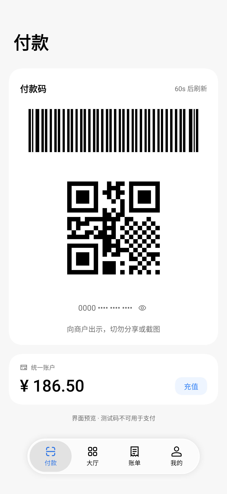
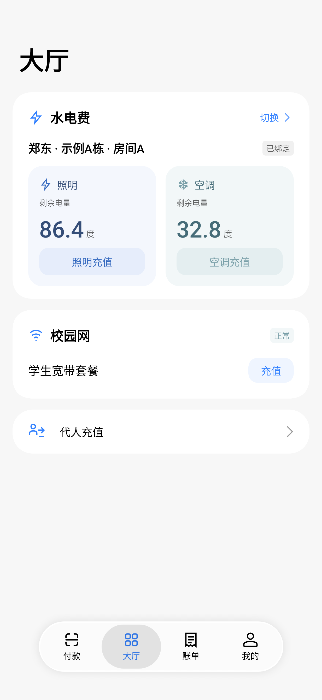
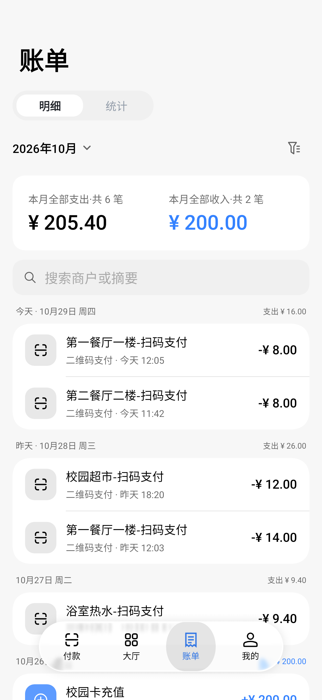
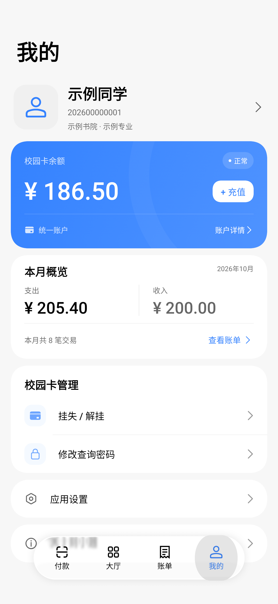

# 财小通 · CaiXiaoTong

河南财经政法大学校园一卡通 Android 客户端，支持付款码、水电与校园网缴费、账单查询和校园卡管理，并接入胖乖接水、洗衣与慧生活798用水服务。使用 Kotlin / Jetpack Compose / miuix 开发。

> 非官方项目，仅供本人账户使用，不隶属于学校或一卡通服务提供方。使用官网内部接口，接口和登录规则可能变化。不要分享密码、Token 或完整付款码。

## 下载与使用

- 系统要求：**Android 14 / API 34 及以上，仅支持 ARM64（arm64-v8a）设备**。
- 更新检测：设置中可关闭默认开启的自动检查，并通过唯一的“检查更新”入口手动查询，右侧显示当前版本；发现更新后打开后端返回的下载页面。检查频率与接口说明见[应用更新检测](docs/app-updates.md)。
- 安装包：[最新正式发布](https://github.com/Mercury000/HUEL-yktwx/releases/latest) · [全部版本](https://github.com/Mercury000/HUEL-yktwx/releases)。如尚无 Release，可按下方构建说明生成 APK。
- 正式安装选择 `CaiXiaoTong-<版本>-release.apk`。`debug` 用于调试，`preview` 使用独立包名用于界面预览。
- 首次打开自动弹出「使用须知与隐私说明」，全文显示至末尾后才能同意；同意后输入本人学号 / 工号及校园卡查询密码登录。须知统一说明一卡通、胖乖生活与慧生活798的账户及业务数据处理。
- 须知正文变更后保留各平台登录信息，进入应用时 Toast 提示并弹出新须知；同意前不发起业务或更新请求、不展示付款码，也不能操作软件功能。不同意、返回或关闭弹层会退出应用，再次打开仍需确认。
- 后续启动在同意记录和登录凭据有效时恢复账户；退出登录位于 **我的 → 应用设置**。同包名、同签名的 APK 可覆盖更新，调试签名与正式签名之间不能直接覆盖安装。

## 功能

| 页面 | 功能 |
| --- | --- |
| 付款 | 二维码与 CODE-128 条形码、点击放大、码号显隐、校园卡余额与本人充值；胖乖接水/洗衣与慧生活798用水共用扫一扫，内联登录并保留服务进度；挂失时显示可点击解挂的内联提示，不阻塞亮码。 |
| 大厅 | 已绑定房间与水电读数、房间管理及临时缴费、校园网套餐与充值、代人充值；按实际项目配置展示一卡通或微信支付方式。 |
| 账单 | 明细与统计、日 / 月 / 年 / 自定义日期范围、搜索和交易类型 / 金额筛选、交易详情、趋势与分类。搜索和筛选只影响明细。 |
| 我的 | 个人资料、校园卡状态与余额、本月收支、挂失 / 解挂和查询密码修改、自定义头像、应用设置与关于页。 |

主题设置支持明暗模式、莫奈强调色、悬浮底栏及 iOS 样式、顶底栏模糊、Miuix / AOSP 转场风格和可选的页面滑动返回。页面转场与系统预测返回采用 miuix demo 的对应实现，详见[页面导航与转场](docs/navigation.md)。自定义头像可从系统照片选择器选取并裁剪，仅在本机显示。

系统预测返回由所选 Miuix / AOSP 转场处理，不设独立开关。普通和悬浮底栏随主页面转场，付款页进度胶囊岛与底栏保持相同的页面位移；页面滑动返回默认关闭，可在主题设置中启用。旋转、窗口尺寸、字号、密度及语言变化在当前 Activity 内适配，保留当前页面栈。

非悬浮导航在宽窗口中切换为左侧栏：宽度达到 840dp，或宽度达到 600dp 且高宽比小于 1.2；首次显示时，宽度达到 1200dp 默认展开。侧栏记忆展开或收起状态，横竖屏切换和重启应用后恢复。两种悬浮样式保持底部居中，iOS 样式按标签数量限制宽度。页面滚动留白包含底栏实际高度，付款页标题固定，余额与充值入口可滚动至底栏上方。

生活服务使用独立平台账号。胖乖接水与洗衣共用登录和扫一扫，服务进度在付款页胶囊岛中保留。协议和恢复规则见[接水说明](docs/life-devices-water.md)与[洗衣说明](docs/life-devices-laundry.md)。慧生活798使用独立账号；共用扫一扫不要求提前登录，识别后等待对应平台恢复账号，未登录时在设备页提示登录，登录后继续查询该设备；798用水规则见[798说明](docs/life-devices-798.md)。两平台账号仍自动恢复和核验，可在设置 → 生活服务账户中核验或退出，登录提醒的关闭选择分别保存；详见[生活服务账户](docs/life-service-accounts.md)。

## 界面预览

下图由原生 Compose 界面在 Robolectric 中渲染，账号、头像、金额、账单及付款码均为虚构预览数据，不代表真实支付结果。

| 付款 | 大厅 | 账单 | 我的 |
| --- | --- | --- | --- |
|  |  |  |  |

## 数据与支付说明

- 余额、个人资料、账单首屏与统计、水电和校园网展示数据采用本地加密缓存。冷启动进入页面先显示已有快照，再联网核对；同一运行中最多复用一分钟的有效数据，可下拉刷新。读取失败保留已有数据并提示，不把未知值当成零。
- “我的”与账户详情独立读取余额和对应校园卡状态，无需先等付款页加载完成；卡状态读取失败不隐藏余额，可刷新或在网络恢复后重试。“我的”本月概览独立查询，不依赖账单明细加载完成。
- 查单确认充值 / 缴费成功后，自动使相关缓存失效：本人充值及一卡通缴费更新自己的余额，代人充值和微信缴费不重查自己的余额；账单与本月概览在对应页面可见时更新，缴费同时更新大厅。无需点击“完成”，用返回键关闭结果也会生效。
- 同一房间的旧缓存读数收到新值后，以短暂淡入淡出和轻微上下移动切换；余额和收支金额使用相同动效，数值不变时不播放。
- 付款码在前台付款页展示，按最多 60 秒或后端更短有效期刷新；离开付款页或后台时移除，返回后重新取码。付款页内的弹层可以保留未过期的背景码，过期后立即隐藏。账户取得后并行查询卡状态和付款码，取码成功即可展示；挂失显示“当前卡片已挂失，可能无法支付，点击解挂”，点击提示打开解挂确认。卡状态查询失败不阻塞亮码，冻结或异常卡状态仍暂停展示，实际能否支付由服务端决定。
- **付款码自动提亮**默认开启，可在 **我的 → 应用设置 → 通用** 中关闭，选择会保存在本机。开启时仅在前台展示有效付款码期间提高当前窗口亮度，离开付款页或进入后台后恢复；关闭后仍保持付款码展示期间屏幕常亮。
- 充值、缴费和卡片操作由用户明确提交；查看目标、切换房间或查询资料不会自动下单。微信回跳及 HTTP 请求成功均不等于支付成功，结果以匹配订单的查单响应为准；结果未明确时先查询，避免重复支付。查询密码修改成功后清除本机登录状态，返回登录页。
- **转回检测支付**默认关闭，需在应用设置中主动开启。它识别手机转向扫码器再转回的动作，最多查询三次同账户余额，减少时按差额显示“支付成功”并刷新付款码；余额不变、增加或查询失败不提示。检测过程不查询账单，确认扣减后会使账单与本月概览失效，待页面可见时更新。这是余额差额推测，不能替代官方交易回执，也不用于充值 / 缴费查单。
- 账密、Token 与业务展示缓存使用 **Android Keystore + AES-GCM** 加密保存在本机，禁用应用数据备份；付款码、订单授权和原始支付配置不持久化。校园卡普通查询遇到 Token 失效最多重登一次，账密无效或需要验证码时停止并要求重新登录。

## 已知限制与验证范围

项目使用官网内部接口，可能随服务端变化而失效。各流程的协议核验、离线回归与真实支付范围分别见 [接口说明](docs/api.md)、[充值调查](docs/recharge.md)、[缴费调查](docs/fees.md) 和 [代人充值调查](docs/others-recharge.md)。

- 已有官网网页本人充值及郑东电费一卡通 / 微信支付的抓包核验；这些记录不能视为本 App 的完整实机支付验证。外部 Android App 唤起微信与支付回跳仍需真机验证。
- 代人充值的跨用户成功下单与到账，以及文北、家属区、商业街和校园网的完整实际支付流程尚未全部验证，不能仅凭离线测试推定可用。
- 官网消费 WebSocket 通知未接入；实验性转回检测的动作阈值与余额更新延迟仍需实际扫码验证。多端取码及离线付款行为未确认，不承诺离线码可用。

- 生活服务依据离线接口证据与模拟测试接入；真实设备扫码、启停和第三方付款仍需真机验证，当前不提供生活服务账单。具体范围见上方各平台说明。

## 开发与构建

### 构建环境

| 项目 | 当前配置 |
| --- | --- |
| Android 最低版本 | Android 14 / API 34 |
| compileSdk / targetSdk | 37 / 37 |
| JDK toolchain | 22 |
| Gradle Wrapper | 9.8.2 |
| Android Gradle Plugin | 9.5.0 |
| Kotlin | 2.4.21 |
| miuix | 0.9.4 |

用 Android Studio 打开仓库，安装 Android SDK Platform 37，设置 SDK 路径并同步 Gradle。`local.properties` 由本机生成，**不要提交**。项目使用 Foojay toolchain resolver，首次构建可能需要联网下载 JDK 和依赖。

慧生活798用水的接口网关与登录签名盐值通过 `HUI798_API_GATEWAY` / `HUI798_SIGN_SALT`，或本机 `local.properties` 的 `hui798.apiGateway` / `hui798.signSalt` 注入。配置和验证范围见[798用水接入](docs/life-devices-798.md)。

CI 在仓库 **Settings → Secrets and variables → Actions → Secrets** 配置 `HUI798_SIGN_SALT`（798登录盐值）、`HUI798_API_GATEWAY`（798接口网关）和 `PANGGUI_API_SECRET`（胖乖接口配置）。未设置网关Secret时使用Gradle默认值。CI Release构建缺少798盐值时失败；PR构建不注入接口Secrets，debug缺配置时仍可编译，但相应平台无法登录。

胖乖生活通过 `PANGGUI_API_SECRET`，或本机 `local.properties` 的 `panggui.apiSecret` 注入接口配置；缺少配置时相应平台无法登录。CI 从同名仓库 Secret 注入，PR 构建不注入接口 Secrets。

友盟 U-App 统计仅在正式包中接入，同意当前须知后启用，业务采用 19 个精简事件。正式 AppKey 和分发渠道通过环境变量或 `local.properties` 注入，缺配置保持停用；debug 和 preview 不包含友盟 SDK。正式包支持官方扫码集成测试，详见[友盟统计接入](docs/umeng-analytics-integration.md)。须知已披露友盟设备识别与接收的数据范围。

在仓库根目录执行：

```powershell
# 可安装的调试版
.\gradlew.bat :app:assembleDebug

# 独立包名的 UI 预览版
.\gradlew.bat :app:assemblePreview

# 压缩优化的正式版，本地构建不配置签名
.\gradlew.bat :app:assembleRelease
```

macOS / Linux 使用 `./gradlew`。

| 变体 | 包名 | 输出 |
| --- | --- | --- |
| debug | `com.mercury.yktwx` | `app/build/outputs/apk/debug/app-debug.apk` |
| preview | `com.mercury.yktwx.preview` | `app/build/outputs/apk/preview/app-preview.apk` |
| release | `com.mercury.yktwx` | `app/build/outputs/apk/release/app-release-unsigned.apk` |

本地 `release` 构建不配置签名，需要签名后才能安装。不要把私钥、密码或签名配置提交到 Git。

`release` 保留 R8 代码优化和资源裁剪，并压缩 APK 内的 DEX，以减小下载文件；`debug` / `preview` 不压缩 DEX，便于快速打包调试。DEX 压缩不改变代码内容，APK 变小不代表安装后的磁盘占用同比减少。

本地默认开启 Gradle 构建缓存、配置缓存和项目并行执行，最多使用 4 个 Gradle worker 控制并发内存峰值（可用 `--max-workers` 覆盖）。重复执行相同构建命令可复用配置；任务输出也可在输入一致时从构建缓存恢复。日常构建无需先执行 `clean`。首次构建仍需要生成缓存；排查配置缓存兼容问题时可临时追加 `--no-configuration-cache`。

### 自动发布

产品版本由 Release Please 版本 PR 管理，读取 `version.txt`；本地编号与 CI 编号偏移读取 `ci-version.properties`。`.github/workflows/build.yml` 共用于 main/beta，自动生成 APK 的全局递增 versionCode：

- main/beta 普通提交：构建 debug 产物；Release Please 自动创建或更新对应分支的版本发布 PR，汇总版本与日志。
- 合并 main 版本 PR：构建 release APK，使用仓库 Actions Secrets（`SIGNING_KEY`、`ALIAS`、`KEYSTORE_PASSWORD`）签名，上传并公开正式 Release。
- 合并 beta 版本 PR：同样构建签名，发布 `1.5.0-beta`、`1.5.0-beta.1` 等 Pre-release，并更新 beta 清单，不抢占 GitHub Latest。
- beta 测试通过后合入 main，由正式版本 PR 发布对应正式版；将正式版本 PR 同步回 beta 后开始下一周期。版本名称与安装编号都不需要逐次手改。
- 也可手动触发 workflow，选择 debug 或 release；手动 release 只构建签名 APK，不创建 Release。

APK 工作流跳过纯文档和生成清单提交，也支持手动运行；只调用对应构建类型的 `assemble` 任务。单元测试和 `lintDebug` 按下方命令在本地按需运行。两个渠道先创建带 tag 的 Draft Release，构建/上传失败时草稿可能保留，但不公开 APK、不切换更新清单。清单任务核对签名证书和五个 CDN 后发布；每日自动续期并补发遗漏的清单。

首次启用权限、Release Please Token 的适用情形、分支流程和失败恢复见 [自动构建与发版](docs/releases.md)，更新签名密钥配置见 [清单上线配置](updates/README.md)。

构建任务使用只读仓库权限，不接触签名 Secrets；release 任务仅在成功的 release 构建后执行，单独取得发布写权限。签名材料缺失时直接失败，不生成标为 release 的未签名安装包；密码通过环境变量传给签名工具，临时密钥文件在任务结束时清理，APK 经 `apksigner verify` 校验后才上传或发布。

Actions 通过 `setup-gradle` 复用依赖和 Gradle 构建缓存，PR 只读取缓存；手动构建及 PR 使用浅克隆，自动发布保留完整历史及 tag。临时 runner 禁用配置缓存，本地配置缓存不受影响。debug artifact 使用较低压缩等级，release 直接上传已签名的 APK；供 release 任务签名的中间产物只保留一天。

### 安装与 UI 预览

```powershell
adb install -r .\app\build\outputs\apk\debug\app-debug.apk
```

首次启动在手机上输入本人学号 / 工号及密码。常规模式默认启用 `FLAG_SECURE`，限制截图及任务预览。

`debug` / `preview` 构建可用虚构码检查 UI；此模式不使用真实账户、不请求付款码：

```powershell
adb install -r .\app\build\outputs\apk\preview\app-preview.apk
adb shell am start -n com.mercury.yktwx.preview/com.mercury.yktwx.MainActivity --ez ui_preview true
```

预览模式关闭截图限制，**不可用于真实付款**。同签名、同包名可覆盖更新；独立 preview 包不与常规包共享账户数据。

预览假数据、提示文案和启动参数仅位于 `app/src/uiPreview/kotlin/`，由 `debug` / `preview` 的 Kotlin source set 编译。`release` 使用 `app/src/production/kotlin/` 的禁用实现；共用代码中的预览分支由 `UiPreview.enabled` 编译期常量关闭，正式包不包含预览数据和文案，传入 `ui_preview` / `ui_preview_lost` 也不会开启预览。

## 测试与验证

```powershell
# Kotlin 数据层、登录协议和请求构造回归测试
.\gradlew.bat :app:testDebugUnitTest --tests "com.mercury.yktwx.data.*"

# Android 静态检查
.\gradlew.bat :app:lintDebug

# 全部 JVM 测试，包括 Robolectric native graphics UI 冒烟测试
.\gradlew.bat :app:testDebugUnitTest

# 正式构建的预览隔离回归（虚构账户，不请求网络）
.\gradlew.bat :app:testReleaseUnitTest --tests "com.mercury.yktwx.UiPreviewIsolationTest"
```

测试优先覆盖金额精度与限额、鉴权、订单响应匹配和支付状态流程。充值流程测试验证重复点击不重复下单、微信回跳不等于支付成功、查单异常不冒报结果，以及取消或切换账户后旧响应不能更新新状态；不依赖弹窗文案和布局。

UI 自动化覆盖页面入口、导航、输入与键盘处理、缓存和加载反馈、账单图表、支付结果联动及已有界面问题的回归；截图使用虚构数据。新增测试应守住实际行为或已复现问题，避免逐项复制实现和文案；它们不代替实机 UI 与支付验证。

界面改动仍需实际运行检查入口、弹窗、键盘输入与页面切换。数据层和状态流程测试使用虚构账密和响应，不向真实登录服务提交数据。真实设备登录、充值和实际扫码支付需在明确授权后另行验证；不要将单元测试通过当成实际消费已验证。

`DashboardPreviewTest` 使用 Robolectric native graphics 直接渲染 Compose 页面，将虚构数据截图写入本机 `tools/dashboard-preview/`。截图选择已有 iOS 样式悬浮底栏，覆盖明暗主题、日期与筛选、个人资料和精确电表入口；这类截图不是设计稿，也不代表实机支付已验证。

## 接口与安全边界

请求顺序和限制见 [接口说明](docs/api.md)。

- 校园卡登录和一卡通业务请求仅向固定 HTTPS 官网发送，不禁用 TLS 校验，不跟随重定向发送账密，不使用浏览器 Cookie。微信 H5 支付桥接仅接受已核验的 `wx.tenpay.com` 路径和 `weixin://wap/pay` 跳转，不向微信传递学校 Token。
- 更新元数据向 `https://cxt.303889.xyz` 独立查询，仅发送包名、安装版本、系统 API 级别和发布通道，不发送账号及业务数据。
- 遇到验证码、首次登录初始化或密码更新要求时停止，不绕过验证。
- 安全键盘是网站请求编码协议；安卓输入仍使用系统键盘，编码后提交。
- 不把真实密码、Token、付款码放进代码、截图、日志、URL、Git 或公开服务。
- 应用允许用户明确提交充值、缴费和卡片操作，不自动下单或重放结果未确认的写请求。消费结果反馈与验证限制见上方说明。
- JVM 字符串不能保证安全擦除内存；加密存储也不等于设备失陷后绝对安全。

## 项目结构

```text
app/
  src/main/java/com/mercury/yktwx/
    data/                 # 接口、登录配置、密码编码、加密存储与账户仓库
    ui/                   # miuix 主题、Tab、页面和分层导航
    MainActivity.kt
    PaymentViewModel.kt
  src/uiPreview/kotlin/   # 仅 debug / preview 编译的预览数据与文案
  src/production/kotlin/  # release 的预览禁用实现
  src/main/res/           # 应用资源、双语文案、备份规则
  src/test/               # 数据层回归测试与 UI 冒烟测试
docs/api.md               # 内部接口协议说明
gradle/wrapper/           # Gradle 引导文件（含 wrapper JAR）
```

`.gitignore` 排除机器 SDK/IDE 配置、缓存、构建产物、`dist/`、签名、账户文件和 HAR 抓包。`tools/` 是本机调试日志、下载文档和截图目录，不提交；README 使用的虚构数据预览图单独保存在 `docs/images/`，应用资源和 Gradle Wrapper 保留。

## 许可证

使用 **GNU GPL v3**，见 [LICENSE](LICENSE)。第三方来源声明见 [NOTICE](NOTICE)。分发 APK 时按许可证要求提供对应源码，保留相关版权和许可证声明。
