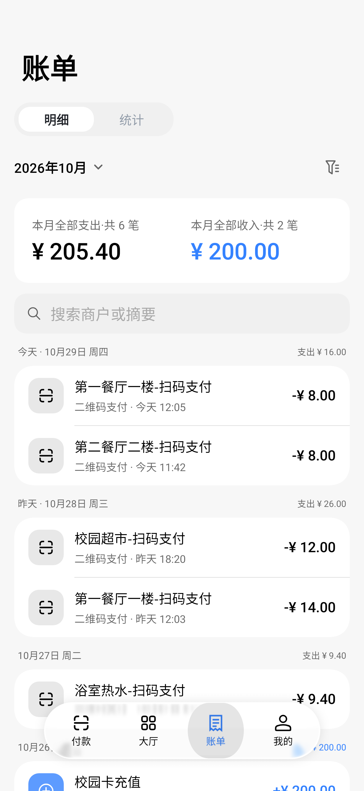
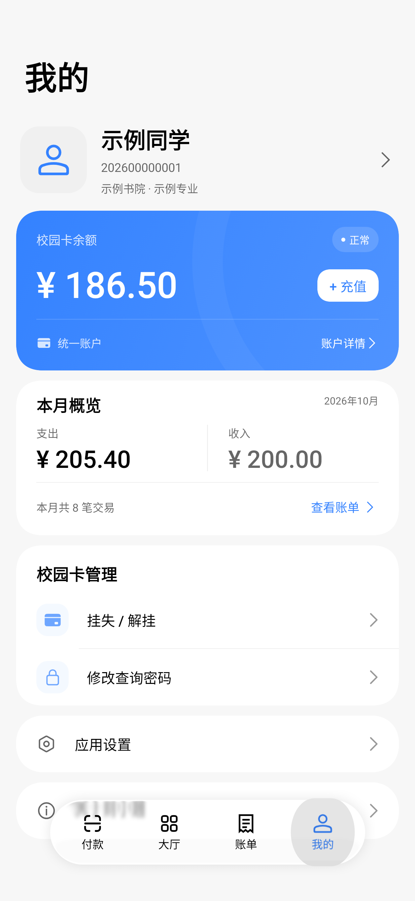

# 财小通

校园一卡通 Android 客户端，使用 Kotlin、Jetpack Compose 和 miuix 开发。

> 非官方项目，不隶属于学校或服务提供方。

## 功能

- 本人校园卡登录、二维码与条形码支付、账户余额查询。
- 账单明细、收支统计和交易详情。
- 本人校园卡充值与微信支付。
- 水电费、校园网缴费与房间管理。
- 校园卡挂失、解挂与代人充值。
- 大厅集中提供生活缴费与校园卡服务。
- 校园卡查询密码修改。
- 账单支持单日、月、年和自定义日期范围。
- 个人资料、校园卡状态与应用设置。
- 账单关键词搜索。
- 本地自定义头像。
- 自动与手动检查应用更新。
- 付款页提供统一的设备扫一扫入口。
- 胖乖接水、洗衣与进行中的设备服务。
- 慧生活798用水设备。
- 生活服务平台账户管理。
- 洗衣银联支付与原订单结果查询。
- 胖乖淋浴后付设备。
- 哈啰单车开锁、锁车、还车、余额与付款。
- 哈啰骑行卡查询与管理。
- 手动输入生活服务设备编号。
- 宽屏侧栏与明暗主题。
- Miuix / AOSP 页面转场和页面滑动返回。

## 安装与使用

支持 Android 14 / API 34 及以上，ARM64 设备。使用本人学号 / 工号与校园卡查询密码登录。

安装包见 [Releases](https://github.com/Mercury000/HUEL-yktwx/releases)。首次启动阅读并同意使用须知。应用更新支持 stable / beta 两个渠道。

## 界面预览

| 付款 | 大厅 | 账单 | 我的 |
| --- | --- | --- | --- |
|  |  |  |  |

预览使用虚构账户与付款码。

## 构建

使用 JDK 22、Android SDK Platform 37 和本版本的 Gradle Wrapper，在 `local.properties` 中配置 Android SDK 路径。

```powershell
.\gradlew.bat :app:assembleDebug
```

macOS / Linux 使用 `./gradlew :app:assembleDebug`。依赖版本以本版本构建配置为准。

## 项目文档

- [开发说明](docs/development.md)
- [项目架构](docs/architecture.md)
- [一卡通接口](docs/api.md)
- [生活服务](docs/life-services.md)
- [应用更新](docs/app-updates.md)
- [构建与发版](docs/releases.md)
- [性能基准](docs/performance-profiles.md)
- [使用统计](docs/analytics.md)

## 许可证

使用 GNU GPL v3，见 [LICENSE](LICENSE)。第三方来源与许可见 [NOTICE](NOTICE)。

