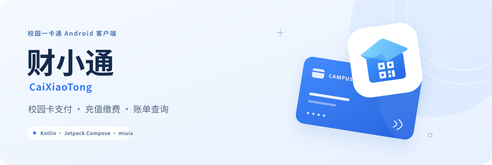
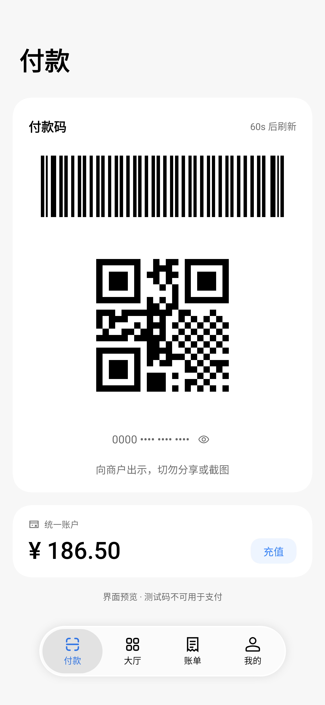
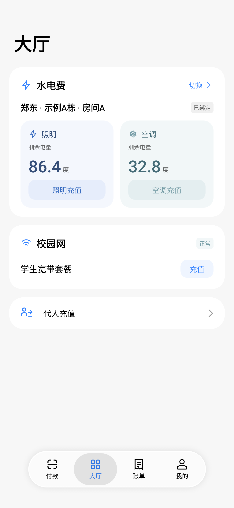

<div align="center">



<p><strong>河南财经政法大学校园一卡通 Android 客户端</strong></p>
<p>使用 Kotlin、Jetpack Compose 和 miuix 开发，支持校园卡支付、充值缴费、账单查询及生活服务。</p>

[](https://github.com/Mercury000/HUEL-yktwx/releases/latest)
[](https://github.com/Mercury000/HUEL-yktwx/actions/workflows/build.yml)
[](https://github.com/Mercury000/HUEL-yktwx/releases)
[](https://github.com/Mercury000/HUEL-yktwx/stargazers)

[](https://github.com/Mercury000/HUEL-yktwx/releases/latest)
[](https://kotlinlang.org/)
[](https://developer.android.com/compose)
[](https://github.com/Mercury000/HUEL-yktwx/blob/main/LICENSE)

**[下载正式版](https://github.com/Mercury000/HUEL-yktwx/releases/latest)** · **[界面预览](#界面预览)** · **[功能介绍](#功能介绍)** · **[项目文档](#项目文档)**

</div>

> 非官方项目，仅供本人账户使用，不隶属于学校或服务提供方。服务端接口变化可能影响部分功能。

## 安装

支持 **Android 14 及以上的 ARM64 设备**。前往 [Releases](https://github.com/Mercury000/HUEL-yktwx/releases/latest)，下载 `CaiXiaoTong-<版本>-release.apk` 安装。

首次启动需阅读并同意使用须知，使用**本人学号 / 工号和校园卡查询密码**登录。应用内支持自动与手动检查更新，以及 **stable / beta** 更新渠道。

## 界面预览

<table>
  <tr>
    <th align="center">付款</th>
    <th align="center">大厅</th>
    <th align="center">账单</th>
    <th align="center">我的</th>
  </tr>
  <tr>
    <td align="center"></td>
    <td align="center"></td>
    <td align="center"></td>
    <td align="center"></td>
  </tr>
</table>

<p align="center"><sub>预览使用虚构账户、金额、账单与付款码，测试码不可用于支付。</sub></p>

## 功能介绍

### 校园一卡通

| 页面 | 功能 |
| :--- | :--- |
| **付款** | 展示二维码与条形码、查看余额、本人充值，扫码进入生活服务 |
| **大厅** | 管理房间、查看水电读数与缴费、充值校园网、代人充值 |
| **账单** | 交易明细、收支统计与趋势，支持关键词搜索及日期、交易类型筛选 |
| **我的** | 查看资料与校园卡状态、挂失 / 解挂、修改查询密码、管理头像与应用设置 |

### 生活服务

付款页支持扫码识别胖乖饮水、淋浴与洗衣设备、慧生活798用水设备和哈啰单车，也支持手动输入设备编号。进行中的服务显示在付款页状态卡，可直接返回对应设备页面。

- **胖乖生活**：饮水与淋浴的开始、结束和状态查询；洗衣程序选择、支付与订单管理。
- **慧生活798**：扫码用水、设备状态查询、开始 / 结束用水与当前设备恢复。
- **哈啰单车**：扫码开锁、临时锁车、继续骑行、还车与付款，以及余额和骑行卡管理。

平台账户在 **我的 → 应用设置 → 生活服务账户** 中管理。操作说明见 [生活服务文档](https://github.com/Mercury000/HUEL-yktwx/blob/main/docs/life-services.md)。

### 界面与主题

支持明暗模式、莫奈配色、默认 / iOS / OS4 导航样式、玻璃效果与模糊、平板侧栏、Miuix / AOSP 转场及可选的页面滑动返回。

## 数据与隐私

凭据和业务展示缓存通过 **Android Keystore + AES-GCM** 加密保存在本机，应用禁用数据备份。付款码、原始支付配置和支付授权不持久化；付款码在离开付款页或进入后台后移除。

充值、缴费与设备操作均由用户明确提交，支付结果以对应订单的服务端查询为准。正式发布包在用户同意使用须知后启用友盟使用统计，具体采集范围与撤销规则见 [使用统计说明](https://github.com/Mercury000/HUEL-yktwx/blob/main/docs/analytics.md)。

## 项目文档

| 内容 | 文档 |
| :--- | :--- |
| 本地开发与构建 | [开发说明](https://github.com/Mercury000/HUEL-yktwx/blob/main/docs/development.md) |
| 网络、缓存与界面状态 | [项目架构](https://github.com/Mercury000/HUEL-yktwx/blob/main/docs/architecture.md) |
| 登录、付款码与充值缴费接口 | [一卡通接口](https://github.com/Mercury000/HUEL-yktwx/blob/main/docs/api.md) |
| 生活服务账户与设备操作 | [生活服务](https://github.com/Mercury000/HUEL-yktwx/blob/main/docs/life-services.md) |
| 应用更新与版本发布 | [应用更新](https://github.com/Mercury000/HUEL-yktwx/blob/main/docs/app-updates.md) · [构建与发版](https://github.com/Mercury000/HUEL-yktwx/blob/main/docs/releases.md) |
| 性能与使用统计 | [性能基准](https://github.com/Mercury000/HUEL-yktwx/blob/main/docs/performance-profiles.md) · [使用统计](https://github.com/Mercury000/HUEL-yktwx/blob/main/docs/analytics.md) |

<details>
<summary><strong>本地构建</strong></summary>

准备 **JDK 22** 和 **Android SDK Platform 37**，在仓库根目录的 `local.properties` 中设置 SDK 路径。依赖访问凭证与生活服务配置按 [开发说明](https://github.com/Mercury000/HUEL-yktwx/blob/main/docs/development.md) 设置。

Windows：

```powershell
.\gradlew.bat :app:assembleDebug
```

macOS / Linux：

```bash
./gradlew :app:assembleDebug
```

界面预览可构建 `:app:assemblePreview`；本地 `:app:assembleRelease` 输出未签名 APK，正式签名与发布由 GitHub Actions 完成。

</details>

## 问题反馈

问题与功能建议通过 [Issues](https://github.com/Mercury000/HUEL-yktwx/issues) 提交，代码贡献通过 [Pull Requests](https://github.com/Mercury000/HUEL-yktwx/pulls) 提交。问题报告应包含应用版本、系统版本、复现步骤和相关日志，并移除账号、密码、付款码及支付凭据。

## 许可证

项目采用 **GNU GPL v3**，详见 [LICENSE](https://github.com/Mercury000/HUEL-yktwx/blob/main/LICENSE)。第三方来源与许可见 [NOTICE](https://github.com/Mercury000/HUEL-yktwx/blob/main/NOTICE)；分发 APK 时需提供对应源码，并保留版权与许可证声明。

