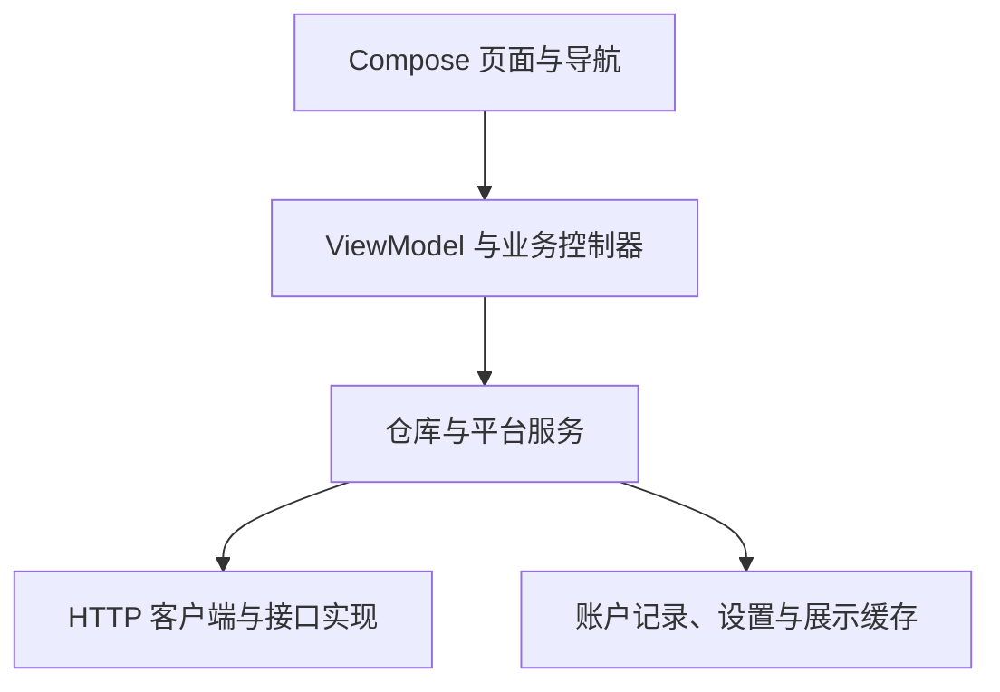

# 项目架构

## 模块与目录

项目采用应用模块内分层的组织方式，`app` 包含客户端功能，`benchmark` 独立负责性能测量与编译资料生成。

| 目录 | 职责 |
| --- | --- |
| `app/src/main/` | 共用应用代码、资源和清单 |
| `app/src/production/` | 正式构建的统计后端与预览禁用实现 |
| `app/src/uiPreview/` | 调试、预览及性能构建的样本数据 |
| `app/src/test/`、`app/src/androidTest/` | 单元测试、界面测试和设备测试 |
| `benchmark/` | 性能基准与 Baseline / Startup Profile 生成 |
| `.github/workflows/` | 构建、发版和更新清单工作流 |
| `.github/scripts/` | 工作流配套工具及测试 |
| `gradle/` | 依赖版本目录与 Gradle Wrapper |
| `updates/` | 更新公钥、策略、来源配置和签名清单 |
| `docs/` | 使用、架构、开发和发布说明 |

应用主包为 `com.mercury.yktwx`：

| 包或文件 | 职责 |
| --- | --- |
| `ui/pages/` | 页面内容与用户操作入口 |
| `ui/components/` | 共用界面组件、扫码和视觉效果 |
| `ui/nav/` | 页面路由、导航与转场 |
| `*ViewModel.kt`、业务控制器 | 页面状态、操作调度与业务流程 |
| `data/` | 一卡通仓库、接口、共享读取、更新与存储 |
| `data/life/` | 胖乖、798、哈啰的平台服务、模型与账户存储 |
| `state/` | 页面与弹层的可恢复状态 DTO |
| `di/` | Hilt 依赖绑定与作用域配置 |
| `analytics/` | 统计事件与授权控制 |

Version Catalog 集中管理依赖版本，Hilt 提供应用、仓库、服务和 ViewModel 的依赖注入，业务 JSON 使用 kotlinx.serialization。

## 依赖关系

页面消费状态并提交用户操作，ViewModel 和业务控制器负责流程调度；数据层处理接口访问、账户归属、记录保存和共享读取。校园卡功能共用 `AccountRepository`，生活服务通过各平台服务接口和账户存储管理设备及订单。

## 网络

OkHttp 共用连接池，支持 HTTP/2、gzip 和取消。校园卡请求限制在固定 HTTPS 源站，平台客户端不交叉传递凭据。写请求不自动重试，结果不明时查询原订单。普通校园卡 Token 失效最多重登一次，验证码或账密错误要求重新登录。

## 展示与刷新

`ReadController`、`SharedReadStore` 和账户仓库协调读取，页面可见性、前后台和网络共同控制请求。离页或失去条件时取消，迟到结果必须匹配原账户和请求版本。

余额、资料、账单首屏与统计、房间读数使用加密展示缓存。冷启动先展示快照再联网核对，同一运行中最多复用一分钟，下拉刷新主动重查。失败保留已有展示，不把未知值当成零。付款码仅在前台付款页展示，按有效期刷新，离页与后台移除。

匹配订单确认成功后使相关数据失效。本人充值和一卡通缴费刷新本人余额，代人充值与微信缴费不重查自己的余额。账单、本月概览和大厅在页面可见时更新，返回或关闭结果弹层不会丢失刷新事件。

## 存储与兼容

凭据和业务记录使用 Android Keystore + AES-GCM、随机 IV 与字段 AAD，成功落盘后才更新内存状态。DataStore 保存设置，头像和展示缓存使用独立文件。付款码、支付授权和原始配置不持久化，应用备份关闭。

仍支持从正式版 1.4.1 直接升级。`StoredRecordJson` 读取历史无版本记录，当前写入 `schemaVersion: 2`，不接受未发布的显式版本 1。单条旧订单只在新列表缺失时恢复，列表保存成功才删除旧记录；已有空列表不复活旧订单。停止支持对应版本后才能移除兼容入口。

`LegacyPreferencesMigration` 是 `ui_settings`、`hall_display`、`app_updates` 三个旧设置文件的唯一读取入口。DataStore 成功保存后删除旧文件，清理失败可重试，不得重新导入或覆盖新值。旧展示缓存直接淘汰并重新查询，不仅凭目录名中的版本号删除仍在使用的文件。

持久字段通过 `@SerialName` 保持稳定，结构变化增加版本并集中转换。未知界面样式显示默认值但保留原存储值；签名策略、版本和字段类型错误严格校验，不静默清空策略。诊断不输出原始 JSON、账户键或凭据。

## 状态恢复

SavedStateHandle 保存带版本、账户和预览标记的 DTO，单份 UTF-8 上限 64 KiB。身份恢复前等待，换号、重新登录或预览身份不符时丢弃。

页面栈、查询条件、草稿和弹层意图可以恢复。设备与订单只保存标识并重新核对，密码、验证码、付款载荷、图片字节和授权不保存。恢复不重放短信、下单、启停、付款、下载或安装，结果未知的原订单保持可查询。

## 界面与主题

Miuix / AOSP 转场处理系统预测返回，配置变化保持页面栈。默认和 OS4 在宽屏使用侧栏，iOS 保持悬浮底栏。宽度达到 840dp，或达到 600dp 且高宽比小于 1.2 时进入侧栏，宽度达到 1200dp 时默认展开，并保存展开偏好。

玻璃风格控制顶栏、弹层、菜单及适用标签，独立于导航样式。顶栏和导航模糊分别控制采样，背景排除自身，无可用 backdrop 或着色器时采用不透明回退。玻璃不折射文字、付款码和输入内容。退出动画期间动作保持禁用。

金额和读数改变时短暂过渡，数值不变不播放。错误在对应操作附近展开与收起，不预留空白。焦点、键盘、安全区和大字号布局使用共享组件。
