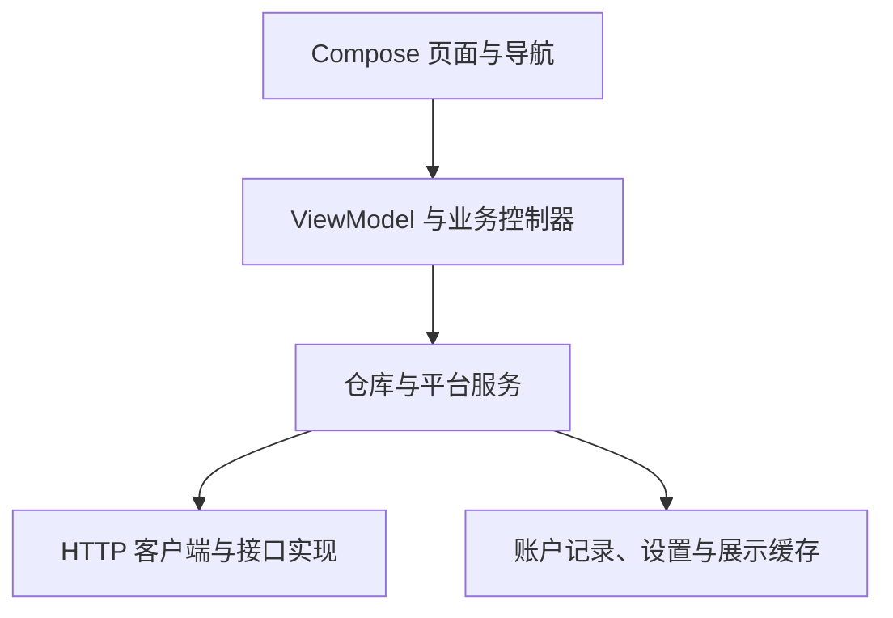

# 项目架构

## 模块与目录

项目在 `app` 模块内分层组织。

| 目录 | 职责 |
| --- | --- |
| `app/src/main/` | 应用代码、资源和清单 |
| `app/src/test/` | 单元与界面测试 |
| `gradle/` | Gradle Wrapper |
| `docs/` | 项目说明 |
| `.github/workflows/` | 自动构建与发版 |

`ui/pages/` 与 `ui/components/` 负责界面，ViewModel 负责页面状态，`data/` 提供接口、账户仓库与加密存储。

## 依赖关系

页面消费状态并提交用户操作，ViewModel 和业务控制器负责流程调度；数据层处理接口访问、账户归属、记录保存和共享读取。校园卡功能共用 `AccountRepository`。

## 网络

校园卡请求限制在固定 HTTPS 源站，使用独立 Token 头并保持 TLS 校验。接口通过平台错误码和服务端信息处理失败，凭据不跨源传递。

## 展示与刷新

页面消费 ViewModel 状态。账户余额与付款码分别更新，失败时保留服务端信息。

## 存储与兼容

凭据通过 Android Keystore + AES-GCM 加密保存在本机。付款码和支付授权不持久化，应用禁用系统数据备份。

设置使用本地偏好存储，业务记录由各数据组件读写。

## 界面与主题

使用 Jetpack Compose 与 miuix，支持明暗模式、强调色、导航样式和模糊设置。

