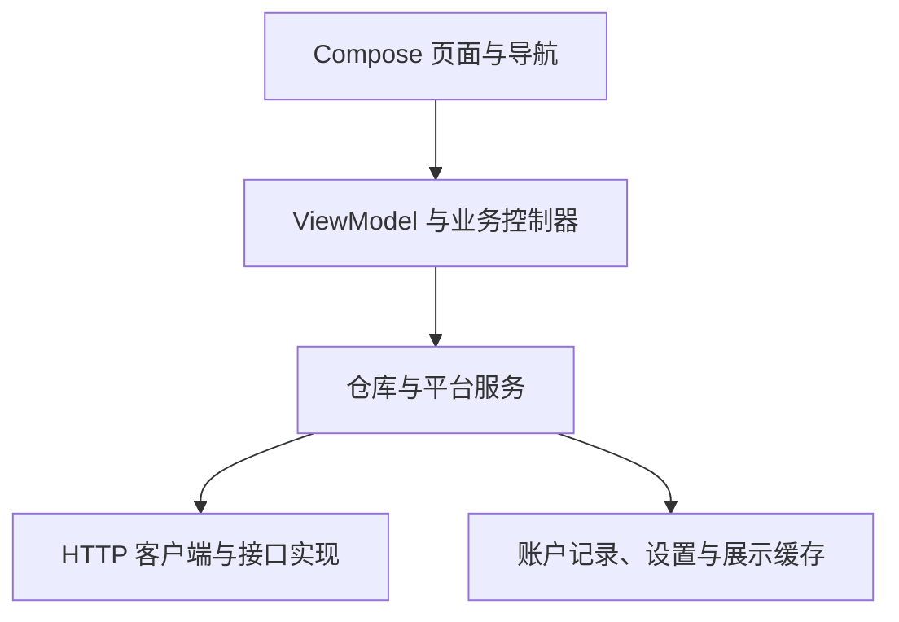

# 项目架构

## 模块与目录

项目在 `app` 模块内分层组织。

| 目录 | 职责 |
| --- | --- |
| `app/src/main/` | 应用代码、资源和清单 |
| `app/src/test/` | 单元与界面测试 |
| `gradle/` | Gradle Wrapper |
| `docs/` | 项目说明 |
| `.github/workflows/` | 自动构建与发版 |
| `app/src/uiPreview/、app/src/production/` | 预览样本与正式实现隔离 |
| `updates/、.github/scripts/` | 签名清单配置与发布工具 |
| `benchmark/` | 性能测量与编译资料生成 |

`ui/pages/` 与 `ui/components/` 负责界面，ViewModel 负责页面状态，`data/` 提供接口、账户仓库与加密存储。

`data/life/` 按平台组织服务、模型与账户记录。

Version Catalog 集中管理插件和依赖版本。

业务 JSON 使用 kotlinx.serialization。

`di/` 使用 Hilt 管理应用依赖与 ViewModel 作用域。

`analytics/` 管理统计事件与授权。

## 依赖关系

页面消费状态并提交用户操作，ViewModel 和业务控制器负责流程调度；数据层处理接口访问、账户归属、记录保存和共享读取。校园卡功能共用 `AccountRepository`，生活服务通过各平台服务接口和账户存储管理设备及订单。

## 网络

OkHttp 共用连接池，支持 HTTP/2、gzip 和取消。校园卡请求限制在固定 HTTPS 源站，平台客户端不交叉传递凭据。写请求不自动重试，结果不明时查询原订单。普通校园卡 Token 失效最多重登一次，验证码或账密错误要求重新登录。

## 展示与刷新

`ReadController`、`SharedReadStore` 和账户仓库协调读取，页面可见性、前后台和网络共同控制请求。离页或失去条件时取消，迟到结果必须匹配原账户和请求版本。

余额、资料、账单首屏与统计、房间读数使用加密展示缓存。冷启动先展示快照再联网核对，同一运行中最多复用一分钟，下拉刷新主动重查。失败保留已有展示，不把未知值当成零。付款码仅在前台付款页展示，按有效期刷新，离页与后台移除。

匹配订单确认成功后使相关数据失效。本人充值和一卡通缴费刷新本人余额，代人充值与微信缴费不重查自己的余额。账单、本月概览和大厅在页面可见时更新，返回或关闭结果弹层不会丢失刷新事件。

## 存储与兼容

凭据和业务记录使用 Android Keystore + AES-GCM、随机 IV 与字段 AAD，成功落盘后才更新内存状态。DataStore 保存设置，头像和展示缓存使用独立文件。付款码、支付授权和原始配置不持久化，应用备份关闭。

仍支持从正式版 1.4.1 直接升级。`StoredRecordJson` 读取历史无版本记录，当前写入 `schemaVersion: 2`，不接受未发布的显式版本 1。单条旧订单只在新列表缺失时恢复，列表保存成功才删除旧记录；已有空列表不复活旧订单。停止支持对应版本后才能移除兼容入口。

`LegacyPreferencesMigration` 是 `ui_settings`、`hall_display`、`app_updates` 三个旧设置文件的唯一读取入口。DataStore 成功保存后删除旧文件，清理失败可重试，不得重新导入或覆盖新值。旧展示缓存直接淘汰并重新查询，不仅凭目录名中的版本号删除仍在使用的文件。

持久字段通过 `@SerialName` 保持稳定，结构变化增加版本并集中转换。未知界面样式显示默认值但保留原存储值；签名策略、版本和字段类型错误严格校验，不静默清空策略。诊断不输出原始 JSON、账户键或凭据。

## 状态恢复

配置变化保留页面栈和滚动状态，侧栏展开偏好保存在本机。

## 界面与主题

使用 Jetpack Compose 与 miuix，支持明暗模式、强调色、导航样式和模糊设置。

宽屏使用侧栏，紧凑窗口使用底部导航；返回手势与页面层级一致。

Miuix / AOSP 转场处理页面切换与系统预测返回。

