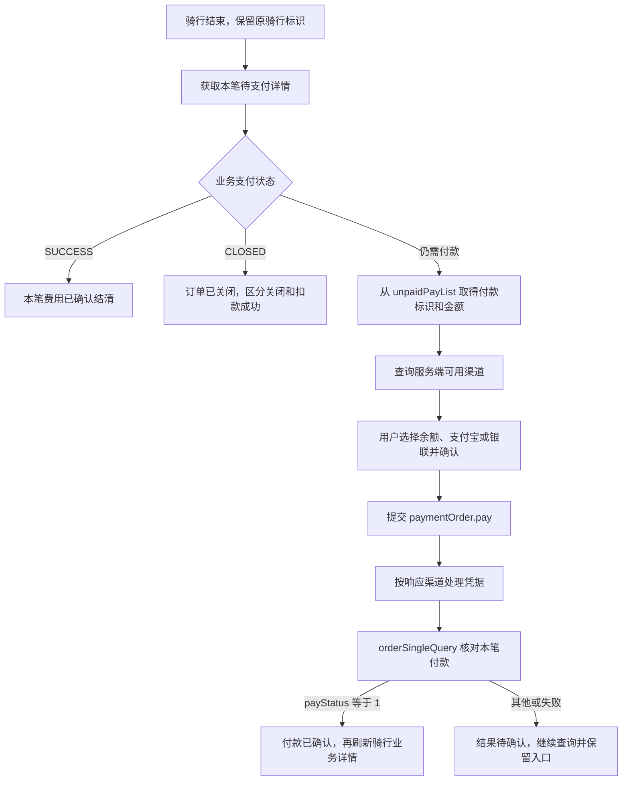

# 哈啰接入补证与实施边界

实施更新（2026-11-13）：本次证据已用于 `feature/hellobike` 的普通网络骑行及普通付款适配，当前行为见[实施说明](life-devices-hellobike.md)。下文保留补证时的来源与判断；实现完成仍不代表已取得真实车辆或扣款证据。

日期：2026-11-12。继续前次[接入评估](hellobike-integration-assessment.md)和[支付分析](hellobike-payment-analysis.md)，落实用户要求：不增加独立页面，复用798／胖乖的公共流程；支付范围仅考虑余额、支付宝、银联，微信SDK渠道排除。

**本次补齐了普通单车待支付业务与通用支付组件之间的连接证据。余额、支付宝、银联都有具体协议或SDK执行依据，可以据此实现适配。登录、网络开还车也有官方APK的请求模型依据。当前仍没有整合包登录、实际开还车和支付成功的在线证据，因此结论是“具备实施依据”，不能写成“已经可用”。**

这与现有生活服务的实现方式一致：公共交互和账户机制复用，平台协议独立适配，异常流程可以交给官方处理。验证程度须分别记录：798和胖乖已有本仓库记录的真实HAR；本次未找到可用于核对哈啰成功骑行的本地原始HAR，不能借用其他平台的成功记录证明哈啰可用。

## 1. 来源、保存与覆盖

- 原APK：`D:/mercu/Downloads/哈啰_7.0.75.apk`，包名`com.jingyao.easybike`，SHA-256仍为`7e7362c0099069334be458347e567b87eb9baf0ab0b1f4ea8a410246d3e7c62b`。
- REA方法补证使用原APK逐字节复制的DEX。先前支付切片含`classes18.dex`和`classes7.dex`；本次分别增加`classes8.dex`登录、`classes2.dex`银联和`classes3.dex`网关切片。切片仅用于静态分析，没有安装或执行。
- 官方公开待支付页：[pr_index_wait-pay.html](https://m.hellobike.com/AppBikeRideCardH5/latest/pr_index_wait-pay.html)。REA的`H5RoutePath.<clinit>`确认路径，`H5Utils.h()`确认生产环境不附加`/fat`、`/uat`或`/pre`。
- 公开页面构建标识：`group_20261102113721`。其引用的入口、业务和支付脚本在本次读取时返回HTTP 200。只读取静态资源，没有运行这些脚本，没有发送账号、短信、开关锁、查单或支付请求。
- 可复核材料保存在[补证归档](hellobike-integration-evidence.json)：切片来源及哈希、REA完整Evidence、原DEX注解和指定登录方法指令、公开脚本下载哈希及函数原文位置。已有支付方法证据继续见[原证据归档](hellobike-apk-evidence.json)。

公开脚本是本次日期的在线静态资源，属于独立来源，不能冒充APK内的历史H5版本。脚本原响应采用gzip时，同时保留原响应与解压后文件的哈希。函数位置使用原解压文本的UTF-16偏移，不是美化后行号。

## 2. 支付范围结论

| 范围 | 已取得的具体证据 | 本项目接入选择 |
| --- | --- | --- |
| 普通支付宝`001` | `HBAliIPayModule`读取`credential.params`并调用`PayTask.payV2(params, true)`；统一支付查单确认`payStatus == 1` | 复用`LifeAlipayActivity`和现有结果接收组件，新增哈啰付款凭据与查单适配 |
| 普通余额`003` | 工厂分派`HBBalancePayModule`；响应`success`或`processing`后进入统一查单 | 实现服务端余额付款和查单，不需要新增第三方唤起SDK；不把`processing`当成功 |
| 银联`1201` | `CUQ_PAY`→`HBCommonPayModule`→`CUQP_PAY`平台→`CUQPPayPlatform`→`CMQPPayActivity`→`UPPayAssistEx.startPay` | 后端返回相应凭据时复用`LifeUnionPayActivity`；参数原样传递，仍按哈啰订单核对结果 |
| 银联／云闪付`1205`、`1207` | 平台映射也到`CUQP_PAY`；同一执行入口可调用SDK | 不因共用执行入口就开放签约或所有云闪付场景，首期仅验证普通银联付款 |
| 微信SDK | `HBWXPayModule.O()`创建`IWXAPI`；`N()`构造`PayReq`，调用`registerApp`和`sendReq` | 按用户要求排除这条渠道，不迁入官方微信AppID或签名环境 |
| 骑行卡、免密签约、复杂组合支付 | H5和APK存在分支，涉及额外协议、预下单、抵扣和签约 | 不作为首期前置要求。官方处理后回到本项目查询本笔订单 |

**三种候选支付方式都需要服务端实际返回可用渠道和凭据。** APK枚举与SDK存在只能证明客户端具备执行能力，不能证明某个用户、城市或单车订单开放该渠道。

银联及微信均已取得实际SDK调用证据，复用依据包括具体SDK发送方法。

## 3. 已补齐的单车付款链路



### 3.1 详情与付款标识

公开待支付页的`fetchOrderDetailData()`调用`waitPayOrderDetail()`，传入`cityCode`、`rideGuid`、`tradeId`、`systemCode`及页面上下文字段。服务方法使用：

```text
POST https://bike.hellobike.com/api
action = user.artemis.pay.page.order.detail
```

`getOrderDetail()`从业务详情取得`rideGuid`、`tradeId`、`bizType`、`orderInfo.payAmount`和`orderInfo.payStatus`。这里的`rideGuid`是骑行业务标识，不能直接假定也是付款标识。

普通“仅支付车费”分支在`handlePay()`中遍历`orderInfo.unpaidPayList`，将每项的`payNo`映射为付款`guid`，`payPrice`映射为付款`amount`。该分支设置`businessScene = "407"`，`bizType == 0`映射`businessType = "1"`（普通单车），另一车型映射`"2"`。默认展示选项`showChannel = ["101"]`属于收银台展示参数，**不是支付宝实际付款渠道`001`**。

脚本的组合支付规范化辅助函数`Ss()`额外把详情`tradeId`作为付款`orderId`，并检查单笔候选、金额和车型；它是另一个业务分支的依据。首期采用普通单笔付款时，不把这个分支的额外字段机械拼入原普通分支，也不从骑行时长自行计算应付金额。

本次由此确认了“单车详情→付款标识与金额→通用收银台”的实际静态调用关系，解决前次仅有通用支付组件、无法知道单车付款参数来源的缺口。

### 3.2 渠道、付款和凭据

原APK的`PayTypeListRequestHelper.b()`构造渠道请求。单笔订单设置`waitPayGuid`与`orderId`，还包含`businessType`、`scene`、地区信息、SDK版本和扩展字段；多笔订单则使用`voucherNos`。对应action为：

```text
com.alphapay.getPayChannel
```

H5支付脚本同样实现该action，并实现：

```text
com.alphapay.paymentOrder.pay
com.alphapay.facade.orderSingleQuery
```

付款提交的完整请求模型与响应分派继续以原证据中的`PayCoreConfirmPayHelper`、`CCbPayConfigRequest`及`HBAllPayManagerKt`为依据，携带业务提供的`amount`、`orders`、`businessType`和用户选中的渠道。收到`ComponentData`后按**响应的`channel`**执行，而不是固守最初选择。

支付宝和银联的普通模块都使用后端的`credential.params`。银联完整执行关系为：

```text
HBCommonPayModule.F()
  credential.params → Bundle[preOrderInfo]
CUQPPayPlatform.startPay()
  preOrderInfo、envType（默认00）→ CMQPPayActivity
CMQPPayActivity.onCreate()
  UPPayAssistEx.startPay(activity, null, null, ORDER_INFO, TRADE_ENVIRONMENT)
```

本项目已有的`LifeUnionPayActivity.startSdk()`也调用`UPPayAssistEx.startPay(this, null, null, tn, "00")`。因此不需要另加银联SDK；须保证实际响应提供普通银联执行参数，禁止用车号、骑行订单号或金额代替交易参数。

余额普通付款在提交后走服务端状态核对。公开支付脚本也提供`user.wallet.accountV2`钱包查询接口，但本次未取得账号的真实钱包响应，不固定假定余额字段、可用金额或抵扣优先级。

### 3.3 两种状态体系不能混用

| 来源 | 字段 | 静态代码已确认的处理 | 本项目应表达的含义 |
| --- | --- | --- | --- |
| 统一支付查单 | 数字`payStatus` | `1`触发支付成功 | 与已提交付款标识匹配时才确认付款成功 |
| 单车待支付详情 | 字符串`orderInfo.payStatus` | `SUCCESS`进入完成分支 | 本笔业务已结清；仍校验骑行／交易标识 |
| 单车待支付详情 | 字符串`orderInfo.payStatus` | `CLOSED`退出待支付页 | 订单已关闭；不能单独据此宣称扣款成功 |
| 骑行结束信息 | `orderInfo.payAmount`等 | 原型只用于展示 | 应付金额；不能充当付款回执 |

H5的`Ss()`内部将`SUCCESS`和`CLOSED`统称为`paid`以决定是否保留待付候选，这只是该辅助函数的名称。迁入本项目时仍应分开“已结清”和“已关闭”，不能照搬这个命名当成资金到账证据。

余额`status=processing`、支付宝／银联SDK回调、HTTP成功、微信或H5回跳都不能替代本笔查单。超时保留待确认；再次付款前先查询，禁止因回调丢失自动重复提交。

## 4. 登录证据与可用性条件

### 4.1 官方原生短信登录

原DEX注解确认：`SendCodeV3Request`对应`user.account.sendCodeV3`；`SlideCaptchaRequest`对应`user.account.slideCaptcha`。`SendCodeV3Request`包含`mobile`、`source`、`captcha`、`challenge`、地区及语言字段，说明不能把所有验证码情形都简化成一个数字偏移。

REA取得`LoginAction`构造方法：它包含`mobile`、`code`、`appChannel`、`ssid`、地区、经纬度、`clientId`、`loginGuid`、`apkSignHash`、OAID等字段。进一步核对`FakeAgainstU.a()`和`b()`，确认`apkSignHash`是读取当前包的首个签名证书字节，再计算SHA-256并用`Base64.DEFAULT`编码所得的字符串；没有在这一步使用官方私钥或服务端挑战。证据另见[签名字段补证](hellobike-signature-evidence.json)。

这个JSON字段可以由本项目固定或配置为从官方APK按同一算法核定的值，因此**不能仅凭存在`apkSignHash`字段就认定原生短信登录不可接入，也无需仅为这个字段改走H5**。固定请求字段不会改变财小通APK真实的签名证书；若后端仅比较该字段，固定值可用于协议兼容，若还核验其他客户端信息，则仍须分别验证。当前未核实服务端实际校验行为，不能把固定字段当成已验证登录成功。编码时还须保留官方Base64格式，包括`DEFAULT`与原型`NO_WRAP`的差异，不能随意改成十六进制摘要。

原始DEX的`VerificationCodePresenterImpl$login$1.invokeSuspend`包含默认`user.account.login`、`LoginAction`构造、`setAction()`及`LoginService.r()`调用；同时读取可配置的验证码登录action。由于REA显示名对多个匿名类发生重名，这一指定协程方法以原DEX指令解码补证保存，**没有把它冒充成成功的REA方法反编译**。REA的外层`login()`、请求构造和网关初始化另有独立Evidence。

源码原型的短信登录不是凭空构造的接口，但其固定版本、字段子集、滑块UI和当前客户端签名仍未核验，不能直接搬入后宣称登录必定成功。

### 4.2 公开H5短信登录候选

同一公开页面引用的脚本含两种登录实现：

```text
user.account.h5Login
user.account.h5loginV2
```

`h5loginV2`分支提交`mobile`、短信`code`、`systemCode`、`thirdInfoToken`，只在响应`code == 0`且返回`token`时发出登录事件。公开脚本还包含滑块图片读取、实际拖动偏移提交及发送短信的方法。

这提供了不同于原生`apkSignHash`链路的**官方H5候选协议**，适合进一步核验后接入共用登录抽屉。当前未验证目标`systemCode`、`thirdInfoToken`要求、会话用户号补齐及会话对骑行／付款接口的适用范围；不能把“不直接携带原生签名哈希”推导为“可以跳过服务端风控”。

首期可保留已有的本地会话导入作为诊断或恢复方式，但导入成功不算账号核验通过。不能把需要用户手动抓Token的方案当成已实现798／胖乖式日常登录。

## 5. 网络开还车基础

原APK的请求模型注解与原型允许的action匹配：

| 阶段 | 原APK类 | action | 原型实现 |
| --- | --- | --- | --- |
| 开锁前预校验 | `PreRideCreateApiModel` | `user.ride.pre.ride` | `RideApi.prepare()` |
| 创建骑行 | `RideCreateApiModel` | `user.ride.create` | `RideApi.create()` |
| 还车位置／确认 | `ManhattanP10PreCloseApiModel` | `ride.hub.pre.close` | `RideApi.preClose()` |

`RideCreateApiModel`的构造方法还包含设备指纹、设备代理、设备ID、定位类型和扫码来源等字段。官方原生模型与原型H5风格字段不是同一个完整客户端环境；**action一致只证明协议存在，不能证明原型省略的字段当前可省略，也不能把任意H5字段与原生字段拼成一个未经依据的请求。**

原型已提供“预校验→价格→用户确认→单次创建→匹配订单查询→还车预校验→单次提交→结束信息”的实现和离线测试源码，具备迁移基础。既有`user.tw.ride.check`与`tw.end.module.info`仍只来自原型／历史实现线索，本次没有取得它们当前成功业务响应；不能补写它们在线已验证。

接入须覆盖：命令前可靠保存、换账号隔离、请求取消、额外停车确认、登录滑块交互。不能把这些公共状态约束当成接口可用性的证明，也不能为“至少可用”而省略它们。

## 6. 首期产品范围

1. 共用付款页扫一扫、`Screen.LifeDevice`、登录容器、生活服务账户设置、进度岛和前后台恢复；域名分平台，`c3x.me`只做本地解析。普通单车10位手输规则仅用于明确平台的上下文，不猜测统一入口的裸数字。
2. 新增哈啰独立账户、协议、定位和骑行状态；跟随现有公共网络层、加密存储和业务任务隔离，不复制轻骑独立Activity、底栏或另一套主题。
3. 骑行结束后查询本笔业务结清状态。有待付款时，仅展示服务端返回且本项目已适配的余额、支付宝、普通银联；没有可用渠道时提供官方处理入口，返回后刷新状态。
4. 骑行卡购买、免密开通、异常停车、实名认证、复杂风控和BLE操作可在官方处理。本项目不需要先复刻这些功能才实现正常网络骑行；遇到要求时停止当前未支持步骤。
5. 骑行结束与费用结清分别记录。付款未知和骑行命令未知都保留已知标识及进度入口，只查询，不补发命令。正常结束可以按现有设备页展示，但待付订单不能因为展示结束金额就被删除。

## 7. “至少可用”的验证门槛

离线实现验收仅覆盖本次直接相关路径：三平台扫码路由、登录分支、账号恢复和切换、保存失败不发送命令、开还车单次提交及订单匹配、还车额外确认、SDK回调不冒报支付、余额processing、待付恢复与查询。无需为评估文档运行构建、全量测试或Lint。

能够将哈啰标为实际可用，还须在整合包中取得以下证据：

- 本人账号正常短信登录或会话核验，能恢复服务端订单；并确认该会话可用于所选骑行和付款协议。
- 真实普通单车二维码、当前位置与地区、预校验和计费规则可读；单次网络开锁后服务端确认骑行，再单次还车并确认结束。
- 至少一种目标支付方式在本笔订单返回有效渠道和凭据，或已有协议实际自动结清；结果由匹配订单的支付／业务查询确认。未开放的其他渠道单独标记为未验证。
- 回调丢失、离页、后台、重启及换账号后能够查询恢复，且不重复开锁、关锁或付款。

**已完成的是上述协议和执行路径补证，尚未实施哈啰业务代码，也没有进行这些真实业务验证。** 本次新增证据不能改变这个事实；它使后续实现具备具体参数来源和兼容边界，避免用枚举、金额展示或历史README替代可用性依据。
