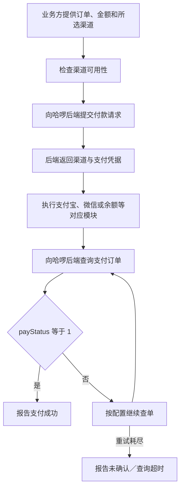

# 哈啰 7.0.75 支付、结算与车号分析

实施更新（2026-11-13）：独立分支已适配普通余额、支付宝、银联付款及原单查询，见[实施说明](life-devices-hellobike.md)。本文保留原型支付缺口与官方静态分析结论；尚未核验真实扣款或骑行费用结清。

分析日期：2026-11-12。目标安装包：`D:/mercu/Downloads/哈啰_7.0.75.apk`。与 `D:/mercu/Desktop/hellobike` 原型源码、财小通当前生活服务接入方式对照。

继续补证见[哈啰接入补证与实施边界](hellobike-integration-evidence.md)：现已取得微信SDK发送、银联SDK调用、生产待支付URL、公开H5单车付款参数来源和原生登录请求依据。支付按用户要求仅考虑余额、支付宝、普通银联，微信SDK渠道排除。本文原证据范围与新补证分别保存，均未验证真实账号、车辆或付款。

**结论：官方 APK 确有支付宝、微信、余额等支付模块，也有支付并签约、免密和骑行卡相关能力。原生付款链路为提交付款请求、执行后端返回的支付渠道、查询订单支付状态；`payStatus == 1` 才报告支付成功。原型目前没有实现这条结清链路，结束金额不能当作扣款成功。普通单车手输车号的完成规则为 10 位；扫码的 `c3x.me` 解析层按域名与参数取编号，没有长度检查。**

## 1. 安装包身份与证据范围

| 项目 | 结果 |
| --- | --- |
| 包名 | `com.jingyao.easybike` |
| 版本 | `7.0.75`，versionCode `1070075` |
| APK 大小 | 156,619,720 字节 |
| SHA-256 | `7e7362c0099069334be458347e567b87eb9baf0ab0b1f4ea8a410246d3e7c62b` |
| DEX 清单 | 20 个 DEX，169,283 个类定义 |
| Manifest | minSdk 21，targetSdk 30 |

使用 REA 检查原始安装包身份及 Flutter 构建信息。完整 DEX 加载受到本机内存限制，因此方法分析改用从原 APK **逐字节复制、未修改**的 `classes18.dex`、`classes7.dex`，同时保留原 Manifest 与资源表。这是静态分析归档，没有安装或执行。归档 SHA-256 为 `0a324bde7bfd7ec83955948edacc53f79287f80cd04f9c785de4cbacb91fc307`。

所选 DEX 包含本报告引用的单车、扫码及支付类。方法结果中的 `complete` 仅表示该次方法输出的覆盖情况；其他 DEX 的实现、跨 DEX 引用、在线 H5 内容及 Dart 函数行为没有完整覆盖。不能用空引用结果证明全 APK 没有某项功能。

[证据归档](hellobike-apk-evidence.json)保留原 APK 身份、复制条目的哈希、REA Evidence ID、方法原文及原 DEX 的接口注解。原生方法以 REA 结果为依据；接口 `ActionValue` 注解另从相同原始 DEX 直接读取，归档中标明两者来源。Flutter 检查只得到构建与部分字符串信息，没有得到足以解释结算的 Dart 函数代码。

没有发送短信、使用账号请求业务接口、尝试付款或操作车辆。具体账号、城市、车型和订单可以使用哪些支付渠道，需要实际业务响应确认。

## 2. APK 有哪些支付能力

`com.hellobike.allpay.paycomponent.model.entity.PayTypeEnum.<clinit>` 定义 50 项支付／签约相关渠道。以下是原始名称与代表代码，属于**整个哈啰 App 的能力清单**，不能推定普通单车全部开放这些方式。

| 渠道组 | APK 中的名称／代码 |
| --- | --- |
| 支付宝 | 支付宝 `001`；支付并免密 `102`；支付宝签约并代扣 `301`；预授权 `106`；芝麻先享后付 `107` |
| 花呗与哈啰月付 | 花呗分期 `103`、支付 `104`、免密 `105`、月月付 `701`、支付并签约 `112`；哈啰月付×花呗 `1040`、支付并签约 `1120` |
| 微信 | 微信 `002`；免密并支付 `204`／`205`；支付并签约 `306`；微信宝付 `206`；小程序 `wxMiniProgram`；小程序拉卡拉 `211` |
| 余额与储值 | 余额 `003`／`013`；惠选储值余额 `020`；商户余额 `1601`；哈啰储值卡 `3001` |
| 银联与云闪付 | 银联 `1201`；云闪付 `1207`；支付并签约 `1205` |
| 数字人民币 | `DCWALLET`；农行 `1302`；建行 `1501`／`1502`；交通银行 `1801` |
| 银行渠道 | 建设银行、民生银行、中国银行、招商银行、农业银行、浦发银行、邮政、北京银行、交通银行，另有宁波银行信用购 |
| 其他 | 京东支付 `2201`；抖音支付 `2302`、先乘后付 `2304`、支付中签约 `2306`、复合签约 `2309`；支付宝小程序及银联全民付支付宝小程序 |

不仅有渠道名称：`HBAllPayModuleFactoryKt.a(Activity, channelCode)` 确实把支付宝相关代码分配给 `HBAliIPayModule`，微信相关代码分配给 `HBWXPayModule`，余额和储值卡分配给 `HBBalancePayModule`；其他分支包括银行、数币、通用支付及小程序模块。首次进一步取得支付宝执行方法和余额处理方法；微信模块执行方法当时未成功取得。最新补证已取得`HBWXPayModule.N()`的`PayReq`构造与`IWXAPI.sendReq()`调用，以及普通银联传递`credential.params`后调用`UPPayAssistEx.startPay()`的完整执行关系，详见补证归档。

关键证据：`method-paytypes-init`、`method-payfactory-a`，均保存在证据归档。

## 3. 原生付款与结清确认怎样做

以下是 `HBPayCore`、`HBAllPayManagerKt` 与支付模块中已取得的方法链路，不代表每笔骑行都必定经过同一种入口。

1. `HBAllPayManagerKt.q()` 检查渠道可用性，再通过 `PayCoreConfirmPayHelper.a()` 构造 `CCbPayConfigRequest`。请求携带业务方提供的 `amount`、`channel`、`businessType`、`orders`，还包含行政区、城市、扩展字段、组合支付信息和返回地址等。
2. `CCbPayConfigRequest` 的原 DEX 注解为 **`com.alphapay.paymentOrder.pay`**。调用 `PayCoreNetService.a()` 获得 `ComponentData` 后，按**响应中的 `channel`**分派模块，不能仅凭最初选项假定后端采用了哪个渠道。
3. 支付宝模块从 `componentData.credential.params` 取得支付参数，执行 **`new PayTask(activity).payV2(params, true)`**。支付凭据来自后端，本地不能只用车号或结束金额拼出支付宝付款请求。
4. 余额模块收到 `status = success` 或 `processing` 都继续进入查单。这里的 `processing` 不直接触发最终成功。
5. `BasePayModule.w()` 构造 `QueryOrderRequest`，包含 `guid`、`orderId`、`businessType`、`extension`。`CheckOrderStatusHelper.k()` 设置 action 为 **`com.alphapay.facade.orderSingleQuery`**，只在非空返回的 **`payStatus == 1`** 时调用成功回调。
6. 默认首次查单延迟为 0，间隔 3000 毫秒，`retryCount = 3`，配置可以覆盖。代码按“首次查询＋最多 3 次重试”执行，不是总共只查 3 次。非成功结果和普通接口失败继续查单；重试耗尽报告查询超时，登录失效单独报错。单次查询方法 `l()` 也使用同一 action 和成功条件。

支付与签约有不同语义。`HBPayCore.b()` 是支付并签约入口，会设置 `payAndGranted = true`，并按签约渠道转换付款渠道。APK 的“免密”“签约并代扣”“预授权”等名称不能直接等同于本笔订单已付清；账号已有协议也不能替代本笔订单查单。

关键证据：`method-confirmpayrequest-a`、`method-allpay-start`、`method-alipay-F`、`method-alipay-I`、`method-balancepay-F`、`method-basepay-query-w`、`method-checkorder-j`／`k`／`l`、`method-paycore-b`。

## 4. 单车骑行结束后如何进入结算

单车 `OrderStateHubHelper.g()` 将订单交给 `com.hellobike.moped.platform.multiport.H5Route.p()`。虽然路由类处在 `moped` 包中，这个调用方是单车订单辅助类。该方法的日志和埋点明确指向“单车待支付跳转”，使用 `H5RoutePath.x()` 的 `WAIT_PAY` 路径，并附上 `rideGuid`、`redPacketMode`、`adSource`、`shouldBypassGray=true`、`finishSource=scan`。首次没有成功取得具体初始化URL；最新REA smali补证确认生产路径为`https://m.hellobike.com/AppBikeRideCardH5/latest/pr_index_wait-pay.html#/wait-pay`。

另一个分支 `OrderStateHubHelper.d()` 路由到 `ride/ride_over/order_detail`，传递 `orderGuid`、`createTime`、来源和结束标记等。由此可以确认官方有待支付页和骑行结束详情入口；在线 H5 页面内部的计费与抵扣行为尚未取得。

原 DEX 中确认的接口 action：

| action | 证据中的请求类／用途 |
| --- | --- |
| `bike.main.getUnpaidOrder` | `BikeWaitPayOrderRequest`，单车待支付订单入口 |
| `user.ride.detail` | `BikeRideDetailRequest`，骑行详情 |
| `user.ali.autopay` | `AutoPayRequest`，支付宝自动支付相关账号信息；`AutoPayInfo` 有 `aliPayAgreementOpen` 字段 |
| `com.alphapay.getPayChannel` | `NewPayTypeListRequest`，支付渠道 |
| `com.alphapay.paymentOrder.getPaymentInfo` | `ThirdPaymentInfoRequest`，支付信息 |
| `com.alphapay.paymentOrder.pay` | `CCbPayConfigRequest`，付款提交 |
| `com.alphapay.facade.orderSingleQuery` | `CheckOrderStatusHelper.k()`／`l()` 在方法内设置，支付订单查询 |

骑行业务的 `PaymentWayResponse` 包含 `manualPayInfo`、`openAliAgreementInfo`、`rideCardPackageInfo`。骑行卡模型有价格、折扣、免费时长和已有卡列表等字段；支付宝协议模型有优惠及选择信息。这证明数据结构覆盖这些方案，尚不能据此确定它们的展示条件、自动扣款时机或抵扣顺序。

**最新公开H5补证已连接“待支付详情 → unpaidPayList中的付款标识与金额 → 通用支付组件”，但尚未完整串起某一笔真实单车订单从关锁到自动扣费的全部调用。** 计费单位、卡券优先级、余额与免密的先后顺序、异常停车费、零元单的结清条件，仍需要接口返回及实际订单证据。统一支付数字`payStatus == 1`与单车详情字符串`SUCCESS`／`CLOSED`属于不同状态体系；`CLOSED`不能单独作为扣款成功证据。其他统一支付状态的完整业务映射也未取得，不能统一当成确定未扣款。

## 5. 官方车号是不是 10 位

是，**普通单车手动输入流程的完成规则为 10 位**。精确代码依据为：

- `BikeManualActivity.init()` 创建 `TextChangeWatcher`，构造函数调用 `super(10)`。
- `TextChangeWatcher.afterTextChanged()` 在 `s.length() == maxLength` 时调用 `onTextFinish()`。
- `BikeOpenLockManualPresenterImpl.inputFinish()` 把输入交给 `CheckBikeNoAction` 核验。该方法有接口失败时的本地回落，所以不能把“进入下一步”当成服务端已证实车号有效。

这里直接证实的是 **10 个字符触发手动输入完成**，尚未单独核实所有输入过滤器或所有车型的编号规则。将它作为普通单车手输编号的 10 位依据成立，不能扩展成所有官方二维码都必须通过“10 位纯数字”检查。

`CodeAnalysisKt.b(url)` 的二维码解析逻辑是：解析 URI，检查 host 等于 `c3x.me`，遍历已注册参数类型，返回第一个非空参数值。此方法没有数字或位数校验，也没有把数字长度用于判定平台。

因此财小通接入仍按**域名确定平台、参数确定业务**；如果在已明确哈啰平台的上下文支持裸车号，可按普通单车 10 位规则校验。统一扫码入口不新增“看到 10 位数字就猜哈啰”的分流，不增加独立输入页。对完整链接的编号若采用更严格规则，应以普通单车实际二维码和服务端预校验补证，不能只凭手动输入完成规则拒绝官方链接。

关键证据：`method-bikemanual-init`、`method-textwatcher-after`、`method-manual-inputfinish`、`method-qranalysis-b`。

## 6. 对现有 hellobike 原型及接入的影响

原型登录由 `LoginApi.java` 实现：向 `https://api.hellobike.com/api` 请求 `user.account.sendCodeV3`，向 `/auth` 请求 `user.account.login`；成功后保存 token、ticket、guid 对应的 userGuid 及行政区信息。还支持完整会话／Token／JSON／HAR 导入，账号由 Android Keystore 与 AES-GCM 保存。当前登录 UI 遇到滑块转官方处理，没有接入滑块交互，也没有实现自动会话刷新。原型请求中的客户端版本为 `6.99.71`，不能仅凭本次 `7.0.75` 的支付代码认定原型登录接口仍可用。本次没有逆向核实官方 7.0.75 的完整登录链路。

原型 `RideApi` 的允许接口只覆盖骑行预校验、开关锁、订单查询和结束信息。开锁前读取 `ridePriceInfo.priceRule`；还车后 `tw.end.module.info` 返回的 `payAmount` 被用于展示。原型没有上述付款提交和支付订单查单，也没有完整支付渠道、骑行卡或免密协议管理。

本次在原始 DEX 字符串中没有找到原型的 `tw.end.module.info`／`user.tw.order.check` 字面值；原型采用 H5／小程序风格接口，官方 APK 又含在线 H5 与 Flutter。这个差异不能用于认定原型接口不存在或失效，也不能把原生 `alphapay` 的状态直接套到原型响应。

接入仍采用[现有生活服务方案](hellobike-integration-assessment.md)：复用 798／胖乖的扫码、设备页、登录抽屉、账号设置、加载与错误展示、进度岛、任务取消、网络层及加密保存。新增哈啰接口适配和状态映射，不能直接共用其他平台的业务接口。

支付方面需补充这些行为：

1. 分别保存“骑行已结束”与“支付已确认”。结束后还有待付费用或结果待确认时，保留现有设备页和进度入口，不因展示结束金额就清除订单。
2. 获取并映射服务端订单、支付信息及当前可用渠道；如果本人账号已有免密协议，也继续核对本笔订单结清结果。默认扣款渠道和扣费结果以业务响应为准。
3. 手动付款在共用设备页中提供操作和结果展示。现有支付唤起能力能复用的部分继续复用，哈啰支付凭据、渠道参数、SDK 身份约束及回调适配需另行核实。
4. 查单超时保持结果待确认，允许恢复查询；查询结果未知不能自动再提交付款，也不能显示已结清。账号切换、离页和重启恢复继续沿用798／胖乖的隔离与生命周期规则。

**开还车基础具备迁移条件；最新补证已为余额、支付宝、普通银联结清提供具体适配依据，仍需实施和实际验证。当前证据不支持宣称“接入后还车即自动结清”或“直接搬原型即可完成支付”。** 仅修改评估文档及保存分析证据，未改业务代码，未运行构建、Lint 或测试；额外网络访问仅为官方公开静态页面和脚本。
