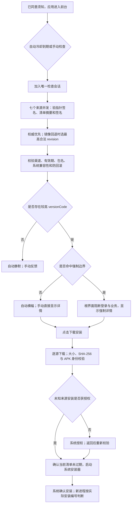
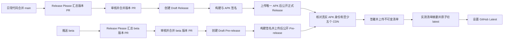

# 更新系统全面复核

复核日期：2026-11-12（Asia/Shanghai）。对象为当前工作区的应用更新实现、相关设置与须知、版本生成和两份发布工作流。本报告以本次读取的代码、定向测试、真实 CDN 下载和 GitHub 配置查询为依据。

**结论：本地实现与相关定向验证通过；线上端到端发布和真实设备安装尚未验收。** 工作区改动尚未进入远端 main，远端没有 beta 分支。不能将本地通过等同于已经上线可用。

## 1. 本次更新的完整内容

| 范围 | 最终行为 | 主要实现 |
| --- | --- | --- |
| 更新来源 | 从 GitHub/CDN 读取签名静态清单，本机判断版本和系统兼容性 | `AppUpdate.kt` |
| 自动检查 | 前台成功冷却 24 小时、失败冷却 1 小时；普通更新只显示横幅 | `AppUpdateViewModel.kt`、`UpdateCheckStore.kt` |
| 手动检查 | 绕过冷却、跳过记录和旧会话结果；加入正在进行的自动请求后也给出明确结果 | 同上 |
| 普通更新 | 横幅/手动入口进入同一详情；跳过此版本、忽略、下载安装三个操作 | `AppUpdateComponents.kt` |
| 提醒记忆 | 跳过版本持久保存；关闭横幅使同版本静默 24 小时；忽略详情保留入口红点 | `UpdateCheckStore.kt` |
| 双渠道 | 设置可订阅测试版；stable 只取 stable，beta 同时取两渠道中的合法较高编号；选择跨升级保留 | `ThemeSettings.kt`、`AppUpdate.kt` |
| 防回滚 | 持久记录最高 revision、摘要、版本和强制边界；拒绝回退及同 revision 内容冲突 | `UpdateCheckStore.kt` |
| 强制更新 | 命中人工边界后由根界面阻断登录与业务页面；无跳过/忽略，返回与自动开关不能解除 | `YktApp.kt`、`AppUpdateViewModel.kt` |
| 更新详情 | miuix 原生弹窗/按钮/进度环；去除装饰图标，展示版本、渠道、本地时间和 Markdown | `AppUpdateComponents.kt`、`UpdateMarkdown.kt` |
| 布局适配 | 版本、时间、日志和错误在有上限的滚动区；操作固定；窄屏/大字体允许两排操作 | 同上 |
| 下载 | 应用私有目录临时文件、多源顺序回退、约 300ms 进度节流、完整校验后原子重命名 | `AppUpdateInstaller.kt` |
| 安装校验 | 每次安装及授权返回重新核对 SHA-256、大小、包名、真实 versionCode 和当前证书集合 | 同上 |
| 安装恢复 | 一个根界面的启动器处理授权/安装回调；授权结果早于前台恢复时等待；取消可重试 | `AppUpdateEffect.kt`、`AppUpdateViewModel.kt` |
| 系统权限 | 非导出 FileProvider 仅共享更新目录；安装由系统授权及确认 | `AndroidManifest.xml`、`update_file_paths.xml` |
| 须知 | 说明 GitHub/CDN 请求、IP、应用内校验和系统安装；正文哈希变化触发重新同意 | `UsageNotice.kt` |
| 产品版本 | 两渠道均用 Release Please 版本 PR，原生预发布策略管理完整 `version.txt` 名称，独立 manifest 保留正式基线 | 两份 `release-please-config*.json` |
| 构建编号 | 两渠道共用 `100000 + github.run_number`，与 beta 预发布序号独立 | `prepare_build_version.py`、`ci-version.properties` |
| 正式发版 | main 普通提交构建 Debug；合并版本 PR 后构建签名并公开正式版，清单成功后设 Latest | `build.yml` |
| 测试发版 | beta 普通推送创建/更新版本 PR；合并版本 PR 后构建签名并公开 Pre-release，更新 beta 指针 | 同上 |
| 清单发布 | 校验唯一真实 APK、签名、渠道及五个不同最终 CDN 主机；先不可变清单，后原子切指针 | `publish_app_update.py` |
| 维护恢复 | 每日北京时间 08:30，剩余有效期 ≤14 天时续签 90 天；补发和修复 GitHub Latest | `publish-updates.yml` |

已有分析/统计相关文件是设计文档，本次更新实现没有接入这些统计功能。普通更新沿用用户确认的横幅交互；手动更新可以弹详情。

## 2. 客户端流程

强制条件为 `currentVersionCode ≤ maxForcedVersionCode 且 latestVersionCode > currentVersionCode`。边界在 `updates/policy.json` 人工维护，发布不得自行清零。两渠道已确认的强制边界均保留；切回 stable 不解除已确认的 beta 强制目标。

## 3. 发布流程与操作者需要做的事

正式和测试发版都由审核并合并版本 PR 触发，不需要手工打 tag、上传 APK 或逐次修改 versionCode。beta 原生版本序列为 `1.5.0-beta`、`1.5.0-beta.1` 等，合入 main 后正式版本 PR 发布 `1.5.0`；将正式版本 PR 同步回 beta，自动推进下一测试周期基线。手动构建仅提供产物。发布失败优先重跑失败任务；已发布唯一 APK 的任务复用原制品，不覆盖同 URL 的字节。

定时维护复查现有发布与清单：到续期阈值时验证 APK/CDN 并续签；两个渠道独立处理，一个失败不会跳过另一个。只有指针成功而 GitHub Latest 失败时，补做 Latest 即可。

## 4. 本轮发现并修复的问题

| 问题与影响 | 修复 | 对应验证 |
| --- | --- | --- |
| release 任务未 checkout，也未声明仓库；`gh release` 无法识别目标 | 发布步骤显式设置 `GH_REPO` | 执行工作流原始发布脚本，使用假的 GitHub 调用核对四种发布/重试分支 |
| 普通目标在当前进程里过期后，失败检查仍保留横幅/红点 | 返回前台或检查结束时清除已过期普通目标与关联下载 | ViewModel 的运行中过期及失败检查回归 |
| 下载/校验期间跨过有效期，仍可能进入系统安装器 | 身份校验后、启动安装器前再次检查当前清单有效期 | 校验中到期测试证明没有启动安装器 |
| 失去联网授权后取消下载，但仍停留忙碌状态 | 清除取消任务并显示可重试状态；关闭自动检查保留活动下载详情 | 下载取消、自动开关与旧回调隔离测试 |
| 发布端只限制封套 1MiB，客户端还限制解码 payload 512KiB | 签名前限制 UTF-8 payload 512KiB | 超长中文日志在发布端拒绝 |
| 候选池未纳入先前已验证可用的第五个最终主机 | 加入 `v6.gh-proxy.org`，仍由发布任务逐次实测筛选 | 实际完整下载参考 Release：五个不同最终主机的哈希一致 |
| 指针已提交而设置 GitHub Latest 失败后，维护可能因无需续签而跳过 | 维护补设 stable Latest，不重签当前清单 | 最新指针已存在时的独立恢复测试 |
| Android Build Tools 37 证书报告使用 `V3.0 Signer:`，原来的 `Signer #1` 解析会拒绝有效 APK | 签名工作流和 Python 同时兼容新旧报告；多个签名方案去重，任一其他证书仍拒绝 | 真实签名工具、工作流原始证书提取步骤及新旧报告回归 |
| aapt2 37 使用 `minSdkVersion`，原来的 `sdkVersion` 解析会阻断清单发布 | APK 身份解析兼容两种最低系统版本字段，仍拒绝 debuggable/缺字段 APK | 对真实压缩 APK执行 aapt2，再调用实际发布脚本 |
| 最后一版要求去除的装饰图标与旧截图不一致 | 当前 miuix 版本已移除图标并重新截图 | 浅深色、小屏、大字体和固定操作位置测试 |

另外修正测试本身的两类问题：旧须知措辞断言与当前正文不符；安装重试/付款二维码测试在后台状态更新后未等待界面同步。保留其原有行为断言，并新增当前更新说明覆盖，复验通过。

## 5. 验收矩阵和证据

| 项目 | 本地验收结论 | 证据/范围 |
| --- | --- | --- |
| 自动/手动共用会话、手动结果、冷却、跳过/忽略 | 通过 | `AppUpdateViewModelTest` |
| 七个 HTTPS 来源、无账号/设备参数、缓存控制、取消断开 | 通过 | `AppUpdateApiTest` |
| 指针与清单验签、摘要、数字类型、过期、同 revision 冲突 | 通过 | 同上 |
| 权威优先、镜像最高 revision、双渠道缺失回退、防回滚 | 通过 | 同上 |
| 渠道选择跨重启、升级保留，切回 stable 不降级 | 通过 | `ThemeSettingsTest`、`AppUpdateApiTest` |
| 强制边界持久保存，实际更高安装编号解除 | 通过 | `AppUpdateApiTest`、ViewModel 测试 |
| 根界面阻断登录和业务、返回与自动开关不能绕过 | 通过 | 新增 `LoginUpdateUiTest` 根界面用例 |
| 第一下载源坏哈希后回退、临时文件清理和安装前重算 | 通过 | `AppUpdateInstallerTest` |
| 错包名/版本/签名拒绝并删除安装包 | 通过 | 同上 |
| 未授权、拒绝授权、授权早于 RESUMED、取消安装、启动失败 | 通过 | `UpdateInstallRecoveryTest` |
| 验证期间元数据到期，不能打开系统安装器 | 通过 | 同上 |
| miuix 浅深色、下载状态操作位置、窄屏、长日志、大字体 | 通过 | `AppUpdateUiTest`、`UpdateReviewUiTest` |
| Markdown 危险 URI、图片/HTML、代码块、本地时间/语言 | 通过 | `UpdatePresentationTest` |
| 更新须知、同意前不联网、保留登录、重建后确认记录 | 通过 | `UsageConsentTest`、`UsageConsentStartupTest`、`UsageNoticeUiTest` |
| 编号、重试身份、push/PR/手动发布门禁 | 通过 | `test_prepare_build_version.py` |
| 正式构建路径、R8 与资源压缩后的 APK 内容 | 通过 | `:app:assembleRelease`；实际 APK 为非 debuggable、beta、100001，更新权限和 FileProvider 已打包 |
| Android 新旧工具输出与证书一致性 | 通过 | 新增签名工作流/最低系统版本回归；实际 Build Tools 37 输出 |
| 实际发布脚本的两阶段提交与失败恢复 | 通过 | 真实 APK/Android 工具/临时 Git；网络替换为固定数据，四种场景通过 |
| Python 清单与 Android 客户端互通 | 通过 | 实际发布脚本生成的公钥、签名指针和清单，交由 Android 验签与缓存恢复 |
| 签名、边界、CDN 数量、续期、重试分类、Latest 恢复 | 通过 | `test_publish_app_update.py` |
| 并发代码提交保留、策略/源配置变更拒绝旧校验发布 | 通过 | `test_update_publish_git.py`：真实临时 Git 仓库 |
| 工作流发布分支与不覆盖 APK | 通过 | `test_release_workflow.py`：原始 shell 脚本与假 GitHub 调用 |
| Actions YAML 与引用版本 | 通过 | 两份 YAML 解析；七个引用均通过 GitHub API 解析为存在的提交 |
| 真实 CDN 可用性 | 当前通过 | 参考 tag `9` 的完整 APK，五个不同最终主机通过；每次新 Release 仍须重新验证 |
| 当前 Secret 与创建 PR 配置 | 已查询 | 更新签名与发布 Token 均存在；Actions 允许创建 PR，默认权限只读 |
| 新工作流线上端到端发布 | 待验收 | 改动尚在本地；真实 keystore/Secret、受保护 main 写入、CDN 新制品预热需线上证明 |
| 真实设备系统授权与覆盖安装 | 待验收 | `adb devices` 没有连接设备；Robolectric 不等同系统安装实测 |

验证累计覆盖 **86 项 Android 定向用例、24 项 Python 定向用例**。本轮新增一个 Android 跨语言互通用例和三项 Python 回归，修改所在的 Python 发布/工作流组共 18 项通过，版本/Git 组沿用此前六项结果；另有四种真实 APK 与本地 Git 发布演练场景。按功能分组运行，没有执行全量应用测试或无关 Lint；正式 APK 构建补验覆盖了 release 的代码与资源压缩路径。

原始结果和截图集中在本轮可视化目录：

`C:/Users/mercu/.codex/visualizations/2026/11/11/01a1cb67-0918-7e81-b66d-8e1d2bc250cf/`

其中 `update-targeted-tests.log` 和 `android-update-summary.txt` 保存 70 项更新用例的成功任务日志与执行后读取的各类结果计数，`root-forced-result.xml` 保存根界面用例，`usage-notice-result.xml` 保存 6 项须知界面结果，`android-consent-results/` 保存 8 项须知/启动结果。大字体 beta 截图的单独复验保存在 `beta-screenshot-result.xml`。Python 发布/版本/Git/工作流用例的通过结果在 `publisher-targeted-tests.log`，最后修改的维护恢复在 `latest-recovery-tests.log`。计数按独立用例合并，重复复验不重复计数。

补验结果在 `release-package-test.log`、`apk-pipeline-result.json`、`android-tools-parser-tests.log` 和 `publisher-android-interop-result.xml`。正式包使用测试编号 `1.5.0-beta.100001`，仅以临时证书用于本地发布衔接验证，未上传、公开或安装。演练中的 GitHub/HTTP 调用均被替换；它证明脚本与真实 APK/工具/本地 Git 的衔接，不证明真实 GitHub 写权限和 CDN 新制品预热。

## 6. CDN 实测

参考正式 APK：tag `9`，版本 `1.4.1`，大小 `5,075,418` 字节。

SHA-256：`233c23cad0f4c86588f42caae394451f4e6abcdb828983210045c877cbaba36b`。

| 通过的起始主机 | 最终主机 | 完整字节与哈希 |
| --- | --- | --- |
| `gh.monlor.com` | `gh.monlor.com` | 一致 |
| `xget.xi-xu.me` | `xget.xi-xu.me` | 一致 |
| `gh-proxy.org` | `gh-proxy.org` | 一致 |
| `v6.gh-proxy.org` | `v6.gh-proxy.org` | 一致 |
| `gh.3w.pm` | `gh.3w.pm` | 一致 |

候选池共 11 个入口，当前其余六个失败。五个通过入口仍属于第三方服务，状态可随时间变化；此次结果证明候选池当前满足最低主机数，不证明未来新制品已经可用。发布任务继续以新 APK 的实际完整 SHA-256 决定是否切换指针，失败保持上一版。

## 7. 实际界面与展示限制

`review.html` 提供 42 张可筛选和放大的真实界面截图：设置、检查中、红点、普通/强制详情、下载、未知大小、校验、授权、安装、错误、小屏、大字体，以及登录/已登录状态的根界面阻断。画廊已在独立浏览器中验证全部图片加载、标签切换、筛选、放大关闭及窄屏布局。

这些图由当前 Kotlin/Compose/miuix 组件在 Robolectric Android 环境直接渲染，背景设置页也使用真实组件。版本与日志为测试数据；它们不是新版本已经发布的证明，也不是手机拍摄画面。客户端/发布流程是解释性示意，与截图分开标注。

## 8. 剩余上线验收

1. 审核当前本地改动并接入 main；按仓库规则处理 PR/审核。
2. 从接入后的 main 建立 beta，使两个渠道共用工作流、编号偏移与公钥。
3. 完成一次新工作流发版，确认真实签名 Secret、APK 公有证书比对、Token 的受保护分支写权限、唯一制品、五个 CDN、新清单和 Latest。
4. 使用 Android 14+、arm64 的设备检验下载、未知来源授权、取消/重试、正常覆盖安装以及强制状态在新进程中的解除。

当前线上配置已不存在“缺少 UPDATE_PUBLISH_TOKEN”这一旧前置问题；其实际权限只能由合法的线上写入证明。已有旧客户端仍需原更新服务器继续服务，直到迁移完成。

## 9. Release Please 双分支流程补充（2026-11-12）

根据用户要求，beta 已改为 Release Please 标准版本 PR 流程，取消每次普通推送直接发版。两份固定配置和两份机器人维护的 manifest 隔离渠道规则及发布记录；正式版本 PR 使用原生 `extra-files` 同步 beta 的正式基线。`versionName` 原样读取工具产生的 `-beta` / `-beta.N` 名称，`versionCode` 仍由同一个工作流自动递增。正式和测试日志都来自 Release Please，两个渠道都先创建带 tag 的草稿，再上传唯一 APK 后公开。

本次新增/受影响路径的验证结果：

| 验证 | 结果与覆盖 |
| --- | --- |
| `test_prepare_build_version`、`test_release_workflow`、`test_publish_app_update` | 24 项 Python 用例通过；普通推送不发版、预发布名称不改写、跨渠道安装编号、精确 commit 恢复、错误渠道/版本拒绝、两渠道草稿上传与重试、beta 候选的产品版本排序 |
| `test_release_please.cjs` | 5 项通过；运行固定 Action 实际依赖的 `release-please@17.3.0`，只替换 GitHub 边界，验证版本 PR 与草稿、`1.4.0 → 1.5.0-beta → beta.1 → 1.5.0 → 1.5.1-beta`、完整正式日志、squash 合并以及旧数字 tag 接入 |
| Android 版本配置 | `:app:generateReleaseBuildConfig` 成功，实际生成 `versionName=1.5.0-beta`、`versionCode=100001`、`UPDATE_CHANNEL=beta`；未追加 APK 全量构建或客户端测试 |
| 工作流与格式 | YAML 解析、双分支配置/manifest 路由及 `git diff --check` 通过 |

这组结果是本次发布流程修改的定向验证，与前述全面复核计数分开记录。没有修改实际 `version.txt` 的 `1.4.1` 或本地默认安装编号 9；没有推送、创建 beta 分支或发布线上 Release。线上验收仍按第 8 节执行。
